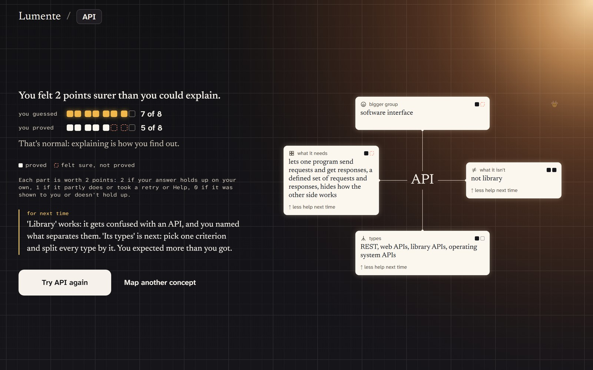
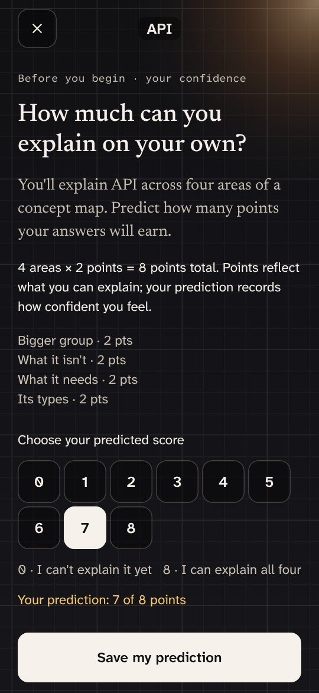
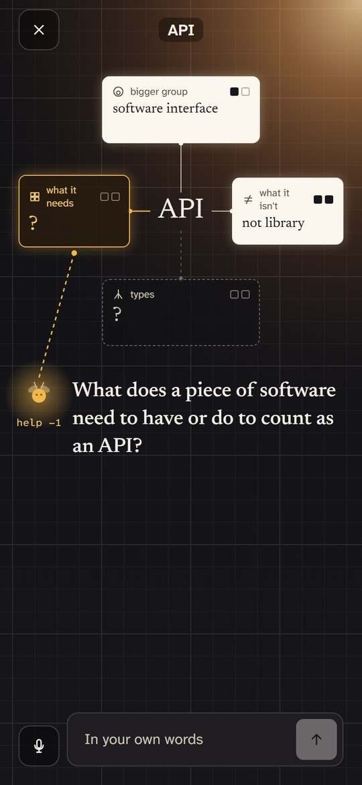
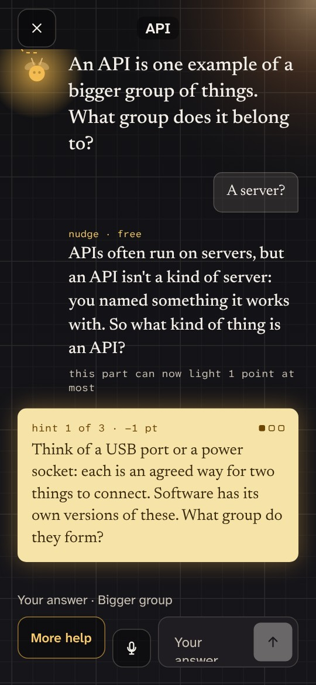
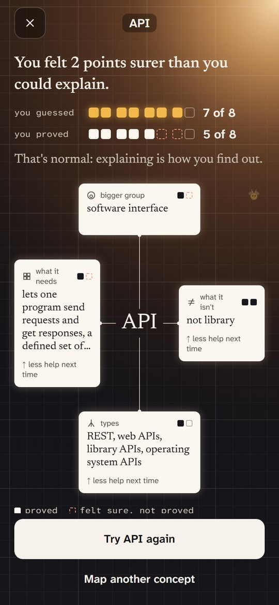
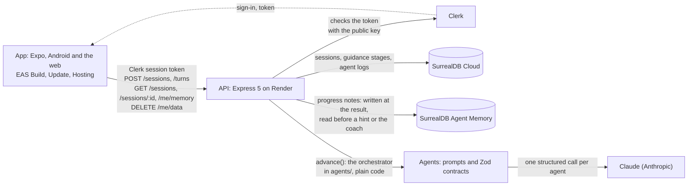

# Lumente

**Build with AI. Explain the concepts yourself.**

Lumente helps programming students who code with AI explain the ideas behind their code, in their own words.

Made for <a href="https://build-north.devpost.com/">Build North</a> (Georgian AI Lab + TapNet), October 2026

The screens on this page come from the app's demo mode, which replays a session recorded live with Claude.

## What it is and who it's for

Lumente is an app for programming students who build projects with AI tools like Claude Code, Cursor or Copilot. The AI writes code that works, and the student often can't explain the ideas behind it.

In Lumente, the student picks one of those ideas and explains it in their own words. At first, the AI asks the questions; as guidance fades, the learner takes over the questioning. Understanding one concept is the immediate result. Learning how to question and unravel the next one is the larger skill.

Lumente accepts concepts beyond programming, but we are starting with programming students who build with AI because that is the first audience we are designing for.

It runs on the web and on Android. On an iPhone or a laptop, the website installs as an app from the browser, with its own icon.

## Why we built it

AI writes code faster than students can understand it. The gap shows when someone asks them to explain it: in a code review, an exam or a job interview. Psychologists call this the illusion of explanatory depth: something feels understood until we try to explain it. AI makes this more common, because code that works feels understood.

- In a [study at Anthropic](https://www.anthropic.com/research/AI-assistance-coding-skills) (January 2026), developers learned a coding tool they'd never used. Those who used an AI assistant scored 50% on a quiz about it. Those who coded by hand scored 67%.
- In [a study at Aalto University](https://www.aalto.fi/en/news/ai-use-makes-us-overestimate-our-cognitive-performance), people solved law-school reasoning problems with ChatGPT. They scored about 3 points better than the norm, but guessed their own score about 4 points too high ([the paper](https://arxiv.org/abs/2409.16708), published in *Computers in Human Behavior*, 2025).

Programming students face this every week. Their AI writes their work every day, and code reviews, project defenses and job interviews check it.

Lumente starts with concepts because they give questioning a concrete structure. We see questioning, driven by curiosity, as a foundational habit of critical thinking. The product helps a student explain an API today while practicing how to unravel the next unfamiliar idea.

## How it works

A session takes about ten minutes. Here is one, with the app's real buttons.

1. **Pick an idea.** The start screen asks: "Can you explain the ideas behind the code your AI wrote?" Tap a concept from your project, like API, JWT or CORS, or type your own. "Use your own project (optional)" gives you a prompt for your coding agent, so the concepts come from your own project, and a field for its answer or your notes. "Explore with guidance" is picked for you; tap "Start with guidance".
2. **Predict your score.** Before any question, you pick a number from 0 to 8. This is not a grade; it captures your confidence at the start. A guide on the same screen says what each of the four map areas can earn. A clear, complete answer on the first try earns 2 points. One after a retry or a hint earns 1. A wrong, empty or revealed answer earns 0.
3. **Explain it in your own words first.** Then the firefly asks about the four areas of the map, one at a time:
   - Bigger group: what kind of thing is it?
   - What it isn't: what is it often confused with, and how is it different?
   - What it needs: what must be true for something to count as one?
   - Its types: what kinds of it are there?

   You type or speak. Any answer you can defend passes. When an area is right, the feedback also says what you left out.
4. **Ask for help whenever you need it.** Tap the firefly. The score keeps independent and supported understanding distinct: the first Help on an area caps it at 1 point, and the third shows the answer for 0. In the early guidance stages, a wrong answer gets a free nudge first. As you handle each area with less help, its guidance stage advances and carries into the next concept, so the support fades.
5. **See your score next to your prediction.** The result says the gap in words, like "You felt 2 points surer than you could explain". Under it, two rows of eight points: your prediction and your map score. That gap shows how well your confidence matched what you could explain. The coach adds one note for next time. "Share" sends your prediction and your score, never your answers.

The guidance stages track independence in the four map areas across concepts; they are not scores for API, CORS or another individual concept. Once guidance has faded across all four areas, the roles flip. You build the whole map yourself: tap an area, write your answer, "Save answer". The firefly's highlight points at the next empty area, for free. "Ask a fact (optional)" opens a chat that answers your questions with facts and never with a part of the map. A hint asks you to confirm and shows how using it affects the score before you choose. "Review & submit", then "Submit my map", scores all four areas together. "Test myself", then "Start self-test", runs this independent mode on any concept immediately and does not change your guidance stages.

Tap any lit area of the map to read your full answer and the feedback on it. If you close the app or reload the page, the session waits on the start screen behind a "Resume" button.

The firefly on screen is the AI. It asks and checks, and its light warms under your finger or pointer. The learner writes the map; asking all the way to a revealed answer scores that area 0.

| Predict | Answer the questions | Get a hint | See your score |
|:---:|:---:|:---:|:---:|
|  |  |  |  |

## What Lumente remembers

After each finished session, Lumente writes a few progress notes to SurrealDB Agent Memory. They hold the guidance stage you had on each area when you practiced that concept, your prediction next to your score, and how many Helps an area took. The stages track independence across concepts, not mastery of the concept named in the note. Each note is one sentence that code writes from a template. Your words never go in.

The next time you practice the same concept, the hint giver and the coach read up to eight of these notes. They name the ones they used: "From what Lumente remembers: …". Tap that line, or "Memory" on the start screen, to see every note and how it changed. A new guidance-stage note replaces the old one and keeps its history.

Memory never changes a score or guidance stage: both still come from plain code. "Delete my data" removes the notes with everything else. Memory has been on since Oct 23 ([`DECISIONS.md`](DECISIONS.md), Oct 23).

## The idea behind it

The name comes from *lumen* and *mente*: light and mind. In the app, questions are the light, and each idea lights up one part at a time as you prove you understand it.

The four questions come from Conceptual Pedagogy, a way of teaching from Colombia, created by Miguel de Zubiría. Here they are for the app's practice example, a planet:

| Question | Answer for a planet |
|---|---|
| What kind of thing is it? | A body in space that doesn't make its own light |
| What is it often confused with? | A star, which makes its own light, and a dwarf planet like Pluto, which hasn't cleared its path |
| What does it need to count as one? | It orbits a star, its own gravity pulled it into a round shape, and it has cleared other objects out of its path |
| What types are there? | Rocky planets like Earth and Mars, and giants made mostly of gas or ice, like Jupiter and Neptune |

Research backs each part: help that fades, asking your own questions, explaining in your own words, and checking what you really know. The AI writes the questions and judges the answers. Plain code works out every score, so we can explain every number.

## Mission and vision

**Mission:** help programming students who build with AI question and explain the concepts behind their own code, so they can unravel unfamiliar ideas with less guidance.

**Vision:** people who think for themselves, with or without AI. Curiosity is the engine, questions are the practice, and understanding is the result. We start with programming ideas and add one thinking skill at a time, and only when the evidence says we're ready.

| Skill | With what |
|---|---|
| Questioning, interpretation, analysis, explanation, self-examination | Concepts: figuring an idea out, telling it apart from similar ones, explaining it in your own words, and checking your prediction against what you proved (built now) |
| Evaluation, inference | What an AI tells you: judging whether its answer holds up and what follows from it |
| Open-mindedness, fair-mindedness | Other perspectives: understanding other points of view before judging them |
| Self-regulation: self-examination and self-correction | Your own assumptions: noticing what you take for granted, and revising it |

Questioning is where it starts, and it runs under every row. The skills and dispositions come from the Delphi Report's consensus definition of critical thinking (Facione, 1990); questioning is its inquisitiveness, the drive to ask. Together, the four rows build critical thinking. We reach people in the same order: programming students first, then any discipline, then workplaces, then hiring, where candidates opt in.

The help fades. The understanding stays.

## Try it

**In two minutes.** Open [Lumente on the web](https://lumente.expo.app) in any browser. Use Google, or choose "Get started" and enter any address that ends in `+clerk_test@example.com` with code `424242`; no inbox is needed. Tap "API", then "Start with guidance". Pick a prediction, explain the idea in your own words, and answer the four questions. Ask the firefly for help once to see how a hint affects the score. The result shows your prediction next to your score.

| On | Do this |
|---|---|
| A laptop, or any phone's browser | Open [Lumente on the web](https://lumente.expo.app). On a laptop or an iPhone, you can add it to the home screen: it opens full screen with its own icon |
| Android | Install the app from [this link](https://expo.dev/artifacts/eas/LVkBl_worJBs2ro5p6z9vFa1XtYyA992vF3QrkSzG_A.apk). Android asks once to allow the install. The app updates itself on its second launch after we ship a fix |
| iPhone | Use the web link. There's no App Store app |

The live addresses:

- The website: https://lumente.expo.app
- The testing build, the same code deployed by hand before a test: https://lumente--testers.expo.app
- The server's health check: https://build-north-api.onrender.com/health answers `{"ok":true}`, with the commit it runs and whether memory is on
- The Android app: the `preview` build linked above (build 3, Oct 22)

The [five-minute guide](docs/testing-notes.md) walks you through a full session, what is stored, and how to delete it.

## Early testing

We shared Lumente with early users, including programming students and people who explored concepts outside programming, through a testing link and individual walkthroughs. Their feedback helped us refine the experience.

## For the judges

| Criterion | Where to look |
|---|---|
| Innovation | The learner builds every answer instead of receiving a completed map. Guidance fades as they become more independent across the four map areas, until they write the whole map and ask the questions. Between sessions, the app remembers their progress, never their words |
| Real-world impact | One clear user, a problem backed by research, and early feedback from real users. Students start with free sessions, then pay for more. Schools, colleges, institutes and bootcamps, our main customers, pay per active learner and see what students could explain, where they needed guidance and how their confidence compared with their performance. Prices come from real usage and willingness to pay |
| UI and design | Lumente's own look: a dark screen that lights up as you prove each answer, and a firefly whose light answers your finger. It works on phones, installs as an app from the browser, and lays out as a two-column website on laptops |
| Tech and deployment | Live on the web and on Android, built, updated and hosted with Expo's EAS. A session survives a reload or a killed app. Only our server talks to the AI, and plain code works out every score |
| Security and ethics | The AI key stays on our server. Notes that look like a password never leave the phone. Memory keeps progress notes, never your words, and you can delete your data from the app. There are no streaks |

<b>How it's built</b>

In short: the app runs on phones and the web, it talks only to our server, and only our server talks to the AI.

| Layer | What |
|---|---|
| App | Expo SDK 58, React Native, Expo Router, TypeScript. EAS Build (Android), EAS Update, EAS Hosting (web). The website is also an installable web app |
| API | Express 5 on Node 24, hosted on Render. SurrealDB Cloud for sessions, guidance stages and AI logs. SurrealDB Agent Memory for the progress notes. Clerk for sign-in |
| Agents | Six Claude (Anthropic) agents. One asks the questions, one checks each answer, one checks the whole map, one answers with facts, one gives hints and one coaches. Each makes one structured call, and plain code runs the session |
| Contracts | Zod schemas in `agents/src/contracts.ts` at every boundary: app to API, API to agents, agents to Claude |

Every call to the server carries the Clerk token, and one route moves a session forward. The server reads it back after a reload, returns what Lumente remembers, and deletes everything on request. The full list is in [`agents/CONTRACTS.md`](agents/CONTRACTS.md).

### Prize tracks

We entered Best Overall, Best Use of Expo, Best Use of Clerk and Best Use of SurrealDB Agent Memory.

<b>Best Use of Expo</b>: one codebase, shipped to Android and the web with EAS

One TypeScript codebase runs on Android and on the web, and the web build installs as an app on iPhones and laptops. There is no App Store app. We had no Apple account this week, so iPhones get the web app ([`DECISIONS.md`](DECISIONS.md), Oct 23).

What EAS did for us, from the [Expo log](docs/expo-log.md), by the Oct 24 freeze:

- **EAS Build:** three Android builds. A development build and a `preview` APK on Oct 21, the day the EAS project was made. Then build 3 on Oct 22, after Lumente's icon and the voice module changed the native code. Build 3 is the APK linked above.
- **EAS Update, with the fingerprint check:** 23 updates over the air on the `preview` channel through Oct 25. The first shipped the same day as the first build. The runtime policy is `fingerprint`, so an update only reaches builds with the same native code. Before an update, `eas fingerprint:compare` checked that build 3 could run it. Fixes went out as updates, and no fourth build was needed.
- **The update notice:** when an update is downloaded, the app says "A new version is ready" with a Restart button. It checks again when it comes back to the foreground and when the start screen shows, at most once a minute.
- **EAS Hosting:** the website, redeployed from `main` with every rollout, at `lumente.expo.app`. The `review`, `testers` and `polish` aliases serve the design review, early testing and our own checks. A web deploy uses no build credit.
- **EAS Workflows:** `ship.yml` publishes the update and deploys the website, and `preview-build.yml` builds an APK when the fingerprint changes. Its first real run stalled in the free queue, so the two jobs ran by hand that day.
- **Expo Observe:** launch times, time to interactive on each screen, and crashes on the Android app. It also reports the crashes a learner recovers from with Try again.
- **The installable web app:** a web manifest, icons and Apple's home-screen tags in the static export. Every shared page gets a link card.
- **The version line:** "Your data" ends with the version and the EAS Update the app runs. A tester or a judge can name exactly what they saw.

From the Expo SDK we use Expo Router, expo-updates, expo-constants, expo-secure-store (the sign-in token), expo-web-browser and expo-auth-session (Clerk's sign-in on Android). Also expo-haptics, expo-font, expo-splash-screen, expo-file-system (the saved session on a phone), expo-dev-client and expo-observe. Answers by voice use expo-speech-recognition, a community module built on the Expo Modules API. Reanimated draws the light and the firefly, and react-native-svg draws the map.

Every build, update and deploy is in the [Expo log](docs/expo-log.md). [How Expo shaped Lumente](docs/expo-log.md#how-expo-shaped-lumente-oct-22) has one line per Expo piece and the job it does. [Challenges we ran into](docs/expo-log.md#challenges-we-ran-into) has the real bugs with their causes and fixes.

<b>Best Use of Clerk</b>: sign-in and sessions, checked on our server without a network call

Clerk runs sign-in and sessions, by email code or Google. We pick the sign-in methods in the Clerk dashboard, with no code change. The website shows Clerk's ready-made sign-in form, and Android opens Clerk's sign-in page in an in-app browser. In the web app installed on an iPhone, the email code signs in without leaving the window. Our server checks each session token with Clerk's public key, without a network call. Every session, guidance stage and progress note is filed under the Clerk user id. Delete my data removes that person's sessions, AI logs, guidance stages and memory notes, and signs them out.

More in [How we used Clerk](docs/clerk.md).

<b>Best Use of SurrealDB Agent Memory</b>: the app remembers each learner's progress across sessions

SurrealDB Cloud stores the sessions, the guidance stages and the AI logs, with a `dev` and a `prod` database. SurrealDB Agent Memory holds the progress notes from [What Lumente remembers](#what-lumente-remembers), one scope per learner under a salted hash of their Clerk id. Code writes each note from a template and sends it as a plain fact. Memory runs no model over it, and the learner's words never go in.

Three agents write the notes (the evaluator the guidance stages, the coach the gap, the hint giver the Helps), and two read them. Before a hint or the coach's message, the server reads up to 8 notes from earlier sessions. If the read takes over 1.5 seconds, the agent runs without them. The agent names the notes it used, the server keeps only the ids it passed in, and the app shows them under the message. A new guidance-stage note supersedes the old one and keeps its history, which is what the Memory sheet shows. Memory never changes a score or stage, Delete my data purges the scope first, and the switch is one server variable. It has been on since Oct 23 ([`DECISIONS.md`](DECISIONS.md), Oct 22 and Oct 23).

## Team

| Name | Role |
|---|---|
| Cynthia Salazar | Team lead: the product, the design and the AI agents |
| Leo Atienza | The server, hosting, Expo builds, sign-in and the memory layer |
| Kyle Argallon | User feedback, the pitch and the video |

---

<b>Disclosures</b>

- We started from Expo's default `create-expo-app` template (SDK 58) and replaced its demo screens, icons and splash screen.
- Fonts: Newsreader (Production Type), and Atkinson Hyperlegible Next and Mono (Braille Institute), under the SIL Open Font License, from `@expo-google-fonts`.
- The images in our design boards (`docs/design/`) are CC0, public domain or from Unsplash.
- Voice input uses `expo-speech-recognition`, a community module. The audio goes to the device's own speech service, and only the words reach us. The app's "Your data" sheet says so.
- AI tools: Lumente's AI runs on Claude (Anthropic), and we built it with Claude Code, with Expo's agent skills and docs loaded.
- Apart from the template, fonts and images above, everything in this repository was built during Build Week.

**For developers:** setup, tests, the repository map and how the team works are in [docs/developers.md](docs/developers.md). The path from a merge to production is in [docs/deploy.md](docs/deploy.md). The contracts between the app, the server and the AI are in [agents/CONTRACTS.md](agents/CONTRACTS.md). Every decision with a trade-off is in [DECISIONS.md](DECISIONS.md).
