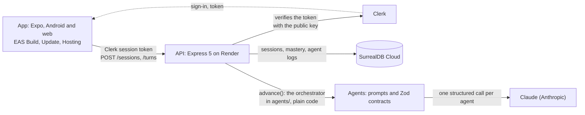

# Lumente

Lumente shows CS students which concepts in their AI-built code they can't explain, and gets them
explaining those concepts in their own words. An AI tutor, the firefly, asks the questions and judges
the answers; it never hands over the answer.

Built for Build North (Georgian AI Lab + TapNet), October 2026. The method, the evidence behind it and
the questions still open are in the [product thesis](wiki/synthesis/product-thesis.md).

## Try it

- Web: https://reality-check.expo.app. Sign in with an email code or with Google.
- Android: the `preview` APK built with EAS Build (Oct 22, version code 3):
  [download](https://expo.dev/artifacts/eas/LVkBl_worJBs2ro5p6z9vFa1XtYyA992vF3QrkSzG_A.apk). Every build
  is listed in [`docs/expo-log.md`](docs/expo-log.md).
- iOS: no build. iPhones use the web build.

Five minutes with it, step by step, with a test sign-in that sends no email:
[`docs/testing-notes.md`](docs/testing-notes.md).

## How a session runs

1. The learner names a concept from their project (API, JWT, CORS) and predicts their score out of 8.
2. They build the concept's map in four parts: its bigger group, what it isn't, what it needs and its
   types. The agents ask the questions and judge the answers; any answer that can be defended passes.
   Hints come only from Help: the first one on a part caps that part at 1 point, and the last step, the
   answer itself, scores 0.
3. The help fades over five levels per part, from a worked example to working alone. At level 5 the
   roles flip: the learner asks, and a fact desk answers with facts only.
4. The real score appears next to the prediction. The evaluator judges each answer; the points, the
   levels and the gap between prediction and score are computed by code, never by the model.

The map is the conceptual mentefact from Conceptual Pedagogy (Miguel de Zubiría).

## Run it from a clean clone

Node 24 (see [`.node-version`](.node-version)). `app`, `api` and `agents` are npm workspaces, so one
install at the root covers all three:

```bash
npm install
npm run start -w app     # the Expo dev server: press w for the browser
npm run dev -w api       # the API on http://localhost:3000, restarts on save
npm test                 # every workspace's tests, no Claude call
```

Phones need the Android development build, since Expo Go does not run SDK 58 yet. The rest is in each
package's README: [`app/README.md`](app/README.md), [`api/README.md`](api/README.md),
[`agents/README.md`](agents/README.md).

- With no `app/.env`, the app runs in demo mode: it replays
  [`agents/fixtures/session-api.json`](agents/fixtures/session-api.json), the API session recorded live
  with Claude, one Turn per action, and needs no API. `EXPO_PUBLIC_API_URL` in `app/.env` points it at
  an API, and `EXPO_PUBLIC_CLERK_PUBLISHABLE_KEY` turns sign-in on.
- The API reads the repo root's `.env` (copy `.env.example`). Its variables, names only: `SURREAL_URL`,
  `SURREAL_NAMESPACE`, `SURREAL_DATABASE`, `SURREAL_USER`, `SURREAL_PASS` and `SURREAL_AUTH_LEVEL` for
  the database; `CLERK_JWT_KEY` to check sign-in tokens; `CORS_ORIGIN` for the web builds' origins;
  `ANTHROPIC_API_KEY` with `AGENT_BUDGET_USD` to turn Claude on, and `AGENT_MODEL` to pick the model;
  `DEV_KEY` for the local dev headers. Without the Claude key, the API replays
  `agents/fixtures/session-1.json` instead of calling Claude.
- `api/` and `agents/` have no build step: Node 24 runs the TypeScript directly.

## Stack

| Layer | What |
|---|---|
| App | Expo SDK 58, React Native, Expo Router, TypeScript. EAS Build (Android), EAS Update, EAS Hosting (web) |
| API | Express 5 on Node 24, hosted on Render. SurrealDB Cloud for sessions, mastery and agent logs. Clerk for sign-in |
| Agents | Claude (Anthropic) agents: questioner, evaluator, whole-map evaluator, fact desk, hint giver, coach. Each is one structured-output call; the orchestrator is plain code |
| Contracts | Zod schemas in `agents/src/contracts.ts` at every boundary: app to API, API to agents, agents to Claude |

How the pieces talk: the app calls only the API, the API is the only thing that calls Claude, and every
arrow carries a Zod-checked shape.



Tests: `node --test` in `app` and `api`, Vitest in `agents`; `npm test` at the root runs all three.
`npm run eval:*` in `agents` runs the prompt evals against Claude and prints the cost.

## Sponsor tracks

**Best Use of Expo.** One TypeScript codebase ships to Android and the web. EAS Build made the Android
development build and the `preview` APK (Oct 21); EAS Update shipped the first JavaScript changes to the
`preview` channel the same day, with no new build; EAS Hosting serves the web build (the `review` and
`testers` aliases, then production). The EAS project lives in the `lumente` organization. From the SDK:
Expo Router, expo-updates, expo-secure-store (the session token), expo-web-browser (Clerk's hosted
sign-in on Android), expo-haptics, expo-font and Expo Observe. Every build, update and deploy is a row
in [`docs/expo-log.md`](docs/expo-log.md).

**Best Use of Clerk.** Clerk handles sign-in and sessions, by email code or Google, set in the Clerk
dashboard with no code change. The web build shows Clerk's prebuilt sign-in; Android opens Clerk's
hosted sign-up and sign-in in an in-app browser. The API checks the session token without a network
call, with the instance's public key, and keys every session and mastery row by the Clerk user id.
Delete my data removes the caller's sessions, agent logs and mastery.

**SurrealDB.** SurrealDB stays the database, with plain tables for sessions and mastery, on a SurrealDB
Cloud instance with a `dev` and a `prod` database. The team does not enter the SurrealDB Agent Memory
prize (decided Oct 22, [`DECISIONS.md`](DECISIONS.md)).

## Template disclosure

The Expo app started from `create-expo-app`'s default template. The template's demo screens, icons and
splash were replaced. Fonts: Newsreader (Production Type) and Atkinson Hyperlegible Next and Mono
(Braille Institute), under the SIL Open Font License, from `@expo-google-fonts`.

## Repository

| Folder | What lives there | Owner |
|---|---|---|
| [`app/`](app/) | Expo + React Native app: Android and web | Cynthia and Leo (Jonathan helped) |
| [`api/`](api/) | Express API: the sign-in check, storage, the Claude calls | Leo |
| [`agents/`](agents/) | Prompts, Zod contracts, fixtures, the orchestrator. Plain TypeScript, no server code | Cynthia |
| [`wiki/`](wiki/index.md) | Project notes: context, research, analysis | Cynthia and Leo |
| Slides (outside the repo) | The pitch presentation | Kyle |

- [`agents/CONTRACTS.md`](agents/CONTRACTS.md): the contracts between the app, the API and the agents.
- [`DECISIONS.md`](DECISIONS.md): every decision with a real trade-off, and why it was taken.
- [`wiki/index.md`](wiki/index.md): the project wiki, starting with the product thesis and the plan.
- [`docs/expo-log.md`](docs/expo-log.md): every EAS build, update and deploy.
- [`docs/tester-protocol.md`](docs/tester-protocol.md): the Oct 23 pilot, five testers (T1 to T5), a
  pre-test and a post-test on concepts they never trained on. Results: TODO after the pilot.

## How the team works

- `main` is protected. Every change goes through a short branch and a pull request, docs included, and
  one teammate reviews. Changes to `agents/CONTRACTS.md` and new `DECISIONS.md` entries arrive the same
  way; the merge is the acceptance.
- The repo is public: no secrets, connection details, keys or tester names in any file. The Claude key
  exists only on the API.
- Stand-in code says `Temporary:` in its comment.
