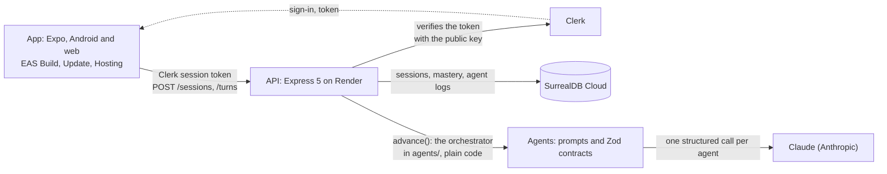

# Lumente

**Build with AI. Understand the concepts yourself.**

Lumente helps students who code with AI learn to explain the ideas behind their code, in their own words.

<!-- TODO(Cynthia): after the Oct 24 freeze, point the Android button at the production build's install page, and swap the two grey badges for the video and Devpost links. -->

Made for <a href="https://build-north.devpost.com/">Build North</a> (Georgian AI Lab + TapNet), October 2026

The screens on this page come from the app's demo mode, which replays a session recorded live with Claude.

## What it is and who it's for

Lumente is an app for computer science students who build projects with AI tools like Claude Code, Cursor or Copilot. The AI writes code that works, and the student often can't explain the ideas behind it.

In Lumente, the student picks one of those ideas and explains it by answering an AI's questions. At the end, they see how well they really know the idea, next to how well they thought they knew it.

It works on the web and on Android. On an iPhone, use the web version.

## Why we built it

AI writes code faster than students can understand it. The gap shows when someone asks them to explain it: in a code review, an exam or a job interview. AI makes this more common, because code that works feels understood.

- In a [study at Anthropic](https://www.anthropic.com/research/AI-assistance-coding-skills) (January 2026), developers learned a coding tool they'd never used. Those who used an AI assistant scored 50% on a quiz about it. Those who coded by hand scored 67%.
- In [two studies at Aalto University](https://www.aalto.fi/en/news/ai-use-makes-us-overestimate-our-cognitive-performance), people who solved problems with ChatGPT did better, but they guessed their own score about 4 points too high.

Programming students face this every week. Their AI writes their work every day, and code reviews, project defenses and job interviews check it.

## How it works

1. Pick an idea from your project, like an API, or type your own. You can paste in your notes about it.
2. Guess your score, out of 8.
3. Answer four questions about the idea, one at a time:
   - What kind of thing is it?
   - What is it often confused with, and how is it different?
   - What does it need to count as one?
   - What types of it are there?
4. If you're stuck, ask for a hint. Each hint costs points, and you get less help as you improve.
5. See your real score next to your guess.

The firefly on screen is the AI. It asks the questions and checks your answers, and you can type or speak. After enough practice, the roles flip: you ask the questions, and the AI only answers with facts.

| Pick and guess | Answer the questions | Get a hint | See your score |
|:---:|:---:|:---:|:---:|
|  |  |  |  |

## The idea behind it

The name comes from *lumen* and *mente*: light and mind. In the app, questions are the light, and each idea lights up one part at a time as you prove you understand it.

The four questions come from Conceptual Pedagogy, a way of teaching from Colombia, created by Miguel de Zubiría. Here they are for the app's practice example, a planet:

| Question | Answer for a planet |
|---|---|
| What kind of thing is it? | A body in space that doesn't make its own light |
| What is it often confused with? | A star, which makes its own light, and a dwarf planet like Pluto, which hasn't cleared its path |
| What does it need to count as one? | It orbits a star, its own gravity pulled it into a round shape, and it has cleared other objects out of its path |
| What types are there? | Rocky planets like Earth and Mars, and giants made mostly of gas or ice, like Jupiter and Neptune |

Each part of the method comes from learning research: help that fades, asking your own questions, explaining in your own words, and checking what you really know. The AI writes the questions and judges the answers. Plain code works out every score, so we can explain every number.

The method, the research and what we haven't proven yet are in the [product thesis](wiki/synthesis/product-thesis.md).

## Mission and vision

<!-- TODO(Cynthia): both lines are drafts from the product thesis ("Where it goes"). Change the wording freely. -->

**Mission:** help students who build with AI understand their own work, by doing the thinking themselves.

**Vision:** people who use AI and still think for themselves. We start with programming ideas and add one thinking skill at a time. We add the next step only when the evidence says we're ready.

| Step | What people practice | Who it's for first |
|---|---|---|
| 1. Concepts (built now) | Explaining an idea and telling it apart from similar ones | Programming students who build with AI |
| 2. Check the AI | Judging whether an AI's answer holds up | Every student, and anyone whose work runs through AI |
| 3. Perspectives | Seeing other points of view | Teens and young adults |
| 4. Decisions | Thinking through choices | Teens and young adults |
| 5. Self-awareness, then the rest of life | The same skills, turned inward | Everyone |

The help fades. The understanding stays.

## Try it

| On | Do this |
|---|---|
| A laptop, or any phone's browser | Open [Lumente on the web](https://reality-check.expo.app) |
| Android | Install the app from [this link](https://expo.dev/artifacts/eas/LVkBl_worJBs2ro5p6z9vFa1XtYyA992vF3QrkSzG_A.apk) |
| iPhone | Use the web link. There's no iPhone app |

Sign in with Google or an email code. To skip the email, use any address that ends in `+clerk_test@example.com` and the code `424242`. The [five-minute guide](docs/testing-notes.md) walks you through a full session.

## What we found

Before Demo Day, five computer science students who code with AI tried Lumente. Each one took a test, did two practice sessions, and took a second test. Both tests were on ideas they hadn't practiced in the app.

*TODO(Cynthia): the pilot's numbers (first test against second test, and the gap between guess and score), and when the testers said they'd open the app.*

## For the judges

| Criterion | Where to look |
|---|---|
| Innovation | The AI won't do the thinking for you. You build each answer, the help fades as you improve, and after enough practice you ask the questions |
| Real-world impact | One clear user, a problem backed by research, and our pilot's numbers. Students use it free. Instructors, bootcamps and colleges pay for seats and a view of what each student has mastered |
| UI and design | Lumente's own look: a dark screen that lights up as you prove each answer. It works on phones, and as a two-column website on laptops |
| Tech and deployment | Live on the web and on Android, built and shipped with Expo. Only our server talks to the AI, and plain code works out every score |
| Security and ethics | The AI key stays on our server. Notes that look like a password never leave the phone. You can delete your data from the app. There are no streaks. Our testers were adults who agreed to take part |

<b>How it's built</b>

In short: the app runs on phones and the web, it talks only to our server, and only our server talks to the AI.

| Layer | What |
|---|---|
| App | Expo SDK 58, React Native, Expo Router, TypeScript. EAS Build (Android), EAS Update, EAS Hosting (web) |
| API | Express 5 on Node 24, hosted on Render. SurrealDB Cloud for sessions, progress and AI logs. Clerk for sign-in |
| Agents | Six Claude (Anthropic) agents: one asks the questions, one checks each answer, one checks all four answers at once, one answers with facts, one gives hints and one coaches. Each makes one structured call, and plain code runs the session |
| Contracts | Zod schemas in `agents/src/contracts.ts` at every boundary: app to API, API to agents, agents to Claude |

### Prize tracks

We entered Best Overall, Best Use of Expo, Best Use of Clerk and Best Use of SurrealDB Agent Memory.

<b>Best Use of Expo</b>: one codebase, shipped to Android and the web with EAS

One TypeScript codebase runs on Android and the web. EAS Build made our Android app, starting Oct 21. EAS Update sends fixes straight to phones with no new install, and it shipped its first one the same day. EAS Hosting serves the website.

From the Expo SDK we use Expo Router, expo-updates, expo-secure-store (keeps the sign-in token), expo-web-browser (Clerk's sign-in on Android), expo-speech-recognition (answers by voice), expo-haptics, expo-font and Expo Observe.

Every build, update and deploy is in the [Expo log](docs/expo-log.md), and [How Expo shaped Lumente](docs/expo-log.md#how-expo-shaped-lumente-oct-22) tells the story, challenges included.

<b>Best Use of Clerk</b>: sign-in and sessions, checked on our server without a network call

Clerk runs sign-in and sessions, by email code or Google. We pick the sign-in methods in the Clerk dashboard, with no code change. The website shows Clerk's ready-made sign-in form, and Android opens Clerk's sign-in page in an in-app browser. Our server checks each session token with Clerk's public key, without a network call, and files every session and progress record under the Clerk user id. Delete my data removes that person's sessions, AI logs and progress.

More in [How we used Clerk](docs/clerk.md).

<b>Best Use of SurrealDB Agent Memory</b>: the app remembers each learner across sessions

<!-- TODO(Cynthia): keep this block only if memory is live at the freeze (plan-to-win, section 4). If the flag stays off, SurrealDB goes back to one line: our database, in plain tables. -->

SurrealDB Cloud stores the sessions, progress and AI logs, with a `dev` and a `prod` database. SurrealDB Agent Memory remembers each learner between sessions: their level on each part, their latest gap between guess and score, and the hints that cost them most. Code writes each memory as a short fact from a template, never in the learner's words, and memory never changes a score. Before the AI gives a hint or advice, our server reads up to 8 of these facts, and the AI names the ones it used, so every message traces back to its facts. Learners see what's remembered, and how it changed, in the app's Memory sheet, and Delete my data erases it ([`DECISIONS.md`](DECISIONS.md), Oct 22).

## Team

<!-- TODO(Cynthia): check each role, and add GitHub or LinkedIn links if you want them. -->

| Name | Role |
|---|---|
| Cynthia Salazar | Team lead: the product, the design and the AI agents |
| Leo Atienza | The server, hosting, Expo builds and sign-in |
| Jonathan *(TODO: last name)* | The app |
| Kyle *(TODO: last name)* | The pilot, the pitch and the video |

---

<b>Disclosures</b>

- We started from Expo's default `create-expo-app` template (SDK 58) and replaced its demo screens, icons and splash screen.
- Fonts: Newsreader (Production Type), and Atkinson Hyperlegible Next and Mono (Braille Institute), under the SIL Open Font License, from `@expo-google-fonts`.
- The images in our design boards (`docs/design/`) are CC0, public domain or from Unsplash.
- AI tools: Lumente's AI runs on Claude (Anthropic), and we built it with Claude Code. *TODO(Cynthia): confirm, and add any other tools.*
- *TODO(Cynthia): confirm that nothing was built before Build Week.*

**For developers:** setup, tests, the repository map and how the team works are in [docs/developers.md](docs/developers.md). The contracts between the app, the server and the AI are in [agents/CONTRACTS.md](agents/CONTRACTS.md), and every decision with a trade-off is in [DECISIONS.md](DECISIONS.md).
