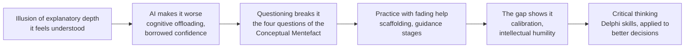
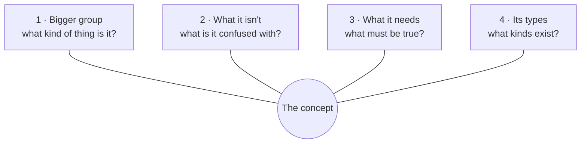

Every name, concept and number Lumente is built on, in one place, with an example and where it shows up in
the app or the Demo Day pitch. Read it top to bottom once to understand the app in depth; after that, use
it as a lookup during Q&A prep. The reasoning that ties these together is in the
[product thesis](../synthesis/product-thesis.md); the raw evidence is in [evidence](evidence.md).

## How it fits together

One chain of ideas runs through the app and the pitch:

The one-line version: **concepts are the tool, questioning is the skill, critical thinking is what it
builds.**

## 1. The problem: why understanding slips

| Term | What it means, with an example | Where it shows up |
|---|---|---|
| Illusion of explanatory depth | People believe they understand how something works much better than they do, until they try to explain it. In the original study, people rated how well they understood a zipper, then explained it step by step, and their ratings dropped (Rozenblit and Keil, 2002) | The pitch's zipper test; the reason the app asks you to explain instead of recognize |
| Cognitive offloading | Using a tool to do thinking you would otherwise do in your head, like a calendar for remembering. Useful, but what you offload you don't practice, so the understanding never forms (Risko and Gilbert, 2016) | Joe's moment in the pitch: the AI wrote the code, so the idea never became his |
| Borrowed vs. earned confidence | Our framing: confidence that comes from the AI's working output is borrowed; confidence from what you proved you can explain is earned. Bandura found the strongest source of self-efficacy is having done it yourself | The slide "AI lends you confidence. Lumente helps you earn your own"; the points measure the earned part |
| Illusion of competence | Feeling you performed better than you did. Struggling novices using AI "thought they performed better than they did" (Prather et al., ICER 2024) | Problem framing, Q&A |

## 2. The method: Conceptual Pedagogy

| Term | What it means, with an example | Where it shows up |
|---|---|---|
| Conceptual Pedagogy | A way of teaching from Colombia, created by Miguel de Zubiría, where understanding a concept means placing it: what it belongs to, what it isn't, what defines it, what kinds exist | The method behind every session |
| Conceptual Mentefact | *Mentefacto conceptual* in Spanish; it has no standard English name. A map of one concept with a fixed shape of four areas. It isn't a list to memorize: the four areas are where questions start | The map you build in the app; the pitch explains it through Bell |
| Genus and differentia | Aristotle's way of defining something: its closest group (genus) plus what makes it different from the rest of that group (differentia). The mentefact follows it | Q&A, if a judge asks why four areas |
| Bigger group | Area 1: "What kind of thing is it?" Checked with one sentence: "An API is a kind of ___". "A software interface" fits; "a server" fails, because an API runs on a server but isn't a kind of server. Related is not the same as belonging | The demo's wall moment |
| What it isn't | Area 2: what it's often confused with, and how it differs. An API isn't a library (a library *has* an API) and isn't a server (a server can host one) | Joe's "API or library?" question is exactly this area |
| What it needs | Area 3: what must be true for something to count as one. An API needs a defined set of requests and responses, and it hides how the other side works | The map |
| Its types | Area 4: the kinds that exist, split by one criterion. APIs by where they live: web, library, operating system | The map |
| Worked example | A solved example shown step by step before you try. Lumente's only one is "planet", kept out of the measured concepts | Guidance stage 1 |

The four areas in a diagram, with two examples:

| Area | Planet (the app's worked example) | Bell's signal, 1967 (the pitch) |
|---|---|---|
| Bigger group | A body in space that doesn't make its own light | A signal from the sky: it kept star time, arriving about 4 minutes earlier each day |
| What it isn't | Not a star (makes its own light), not a dwarf planet like Pluto (hasn't cleared its path) | Not interference, not a quasar, not "little green men": a second one appeared elsewhere in the sky |
| What it needs | Orbits a star, is round from its own gravity, has cleared its path | A pulse every 1.33 seconds, regular as a clock |
| Its types | Rocky planets, gas and ice giants | None that fit, so a new type: the pulsar |

## 3. The learning science behind the design

| Term | What it means, with an example | Where it shows up |
|---|---|---|
| Scaffolding | A tutor's support that lets a learner do what they can't yet do alone, taken away as they improve (Wood, Bruner and Ross, 1976) | The five guidance stages |
| Fading | The "taken away" part of scaffolding: less help as competence grows | "The help fades. The understanding stays." |
| Cognitive apprenticeship | Scaffolding turned into a sequence: show, guide, then step back (Collins, Brown and Newman, 1989) | Stages 1 to 5: watch, guided, complete, named only, alone |
| Assistance dilemma | Too little help frustrates; too much makes learning shallow (Koedinger and Aleven, 2007) | Help only when you ask, and it shows in the score; a free nudge only at early stages |
| Self-explanation effect | Students who explain material to themselves while studying understand it better (Chi et al., 1994) | Every answer in your own words, starting with a first explanation |
| Question generation | Students taught to generate their own questions understood new material better, median effect size 0.36 (Rosenshine, Meister and Chapman, 1996) | Stage 5: the roles flip and you ask |
| Information-gap theory | Curiosity appears when we notice a gap between what we know and want to know, strongest when it feels closeable (Loewenstein, 1994) | The empty areas of the map make the gap visible |
| Desirable difficulty | Some difficulty during learning, like retrieving instead of rereading, makes learning slower but more durable (Bjork, 1994) | Why a session is hard on purpose; Kyle's buoyancy test: frustration helps when you care |
| Self-efficacy | The belief that you can do something; its strongest source is having done it yourself (Bandura, 1977) | Earned confidence |
| Self-Determination Theory | People stay motivated when they feel competent, in control and connected (Ryan and Deci, 2000) | Why no streaks: the reason to return is your own progress |
| Transfer | Using what you learned somewhere new. Knowledge tied to one context is hard to use elsewhere; comparing examples helps (Gick and Holyoak, 1983) | Why concepts are practiced outside the coding agent |
| Calibration | How well your confidence matches your performance. Part of metacognition, thinking about your own thinking | The prediction against the map score |

## 4. Critical thinking: the skills Lumente builds

The **Delphi Report** (Facione, 1990) is a consensus definition of critical thinking from a panel of experts:
six skills, plus the dispositions, meaning the habits and willingness to use them.

| Skill | What it means | Its sub-skills (Delphi) | In Lumente |
|---|---|---|---|
| Interpretation | Working out what something means | Categorization, decoding significance, clarifying meaning | Building the map: categorization is the bigger group |
| Analysis | How the parts relate | Examining ideas, identifying arguments | "What it isn't" and "what it needs" |
| Evaluation | Judging whether a claim or argument holds up | Assessing claims, assessing arguments | Phase 2, Check the AI |
| Inference | Drawing conclusions from evidence | Querying evidence, conjecturing alternatives, drawing conclusions | Stage 5: turning the fact desk's facts into the map. "Querying evidence" is questioning |
| Explanation | Stating and justifying your reasoning | Stating results, justifying procedures, presenting arguments | Answers in your own words (partial: no "justify why" step yet) |
| Self-regulation | Checking your own thinking | Self-examination, self-correction | The prediction gap now; phase 4, your own assumptions |

| Disposition | What it means | In Lumente |
|---|---|---|
| Curiosity | Wanting to know, and asking | Questions asked at stage 5 (a stand-in measure) |
| Intellectual humility | Knowing the limits of what you know | The gap between felt and proved (a stand-in measure) |
| Open-mindedness | Considering other views | Phase 3, Perspectives; already, any defensible answer passes |

**Decisions** are not a Delphi skill. A decision is where all the skills get used at once, so in the
expansion it is the outcome, not a phase. Joe's "API or library?" breaks down like this: knowing what each
is and isn't (concepts), checking claims about them (evaluation), hearing why a teammate would choose
differently (open-mindedness), noticing you pick what you already know (self-regulation), concluding
(inference). Practicing skills separately doesn't guarantee good decisions; transfer has to be practiced
too.

## 5. Inside the app

| Term | What it means | Where it lives |
|---|---|---|
| Prediction | Your guess, 0 to 8, before any question: confidence on record. "Your prediction reflects your confidence; your score reflects what you can explain" | The prediction screen |
| Map score | Points earned on the four areas, 2 each | The result |
| The 2/1/0 rubric | 2 for a clear, complete answer on the first try; 1 after a retry or a Help; 0 for wrong, empty or revealed | `agents/CONTRACTS.md` section 3 |
| The gap | Prediction minus map score, said in words: "You felt 2 points surer than you could explain." Never a bare signed number, so it isn't read as a grade (DECISIONS.md, Oct 22) | The result |
| Guidance stages | Five stages per map area, across concepts: watch, guided, complete, named only, alone. They track independence, not mastery of one concept | Memory sheet |
| Help and the free nudge | Help is always there; the first caps the area at 1 point, the third reveals the answer for 0. A wrong answer at early stages gets a free nudge first | The firefly |
| The roles flip | Once all four areas reach the last stage, you build the whole map and ask the questions | Independent practice |
| Fact desk | Answers factual questions with facts, never with part of the map; a question fishing for the map gets a fixed line written by code | "Ask a fact (optional)" |
| The six agents | Questioner, evaluator, whole-map evaluator, fact desk, hint giver, coach: one structured Claude call each | `agents/` |
| Numbers in code, words in the model | Claude writes questions, judges meaning and words feedback; plain code applies the rubric and computes every score and stage. Claude still judges whether an answer is right, so this means the rules are fixed, not that grading is objective | The orchestrator, `agents/src/orchestrator/` |
| Progress notes | What SurrealDB Agent Memory keeps: one-sentence facts code writes from templates, never the learner's words. The main database does keep sessions and transcripts; Delete my data removes everything | README, "What Lumente remembers" |

## 6. The pitch story

| Element | What it is | Why it's there |
|---|---|---|
| Jocelyn Bell | In 1967, as a 24-year-old PhD student at Cambridge, she noticed "a bit of scruff" on miles of chart paper, asked what it was, and found the first pulsar. The team jokingly named it LGM-1, for "little green men" | Opens the pitch: discovery starts with questioning what others filed as noise; her questions map onto the four areas |
| The zipper test | "How well do you understand how a zipper works, 1 to 7? Now explain how the teeth lock." | Lets the audience feel the illusion of explanatory depth instead of hearing about it; it mirrors the app's predict-then-explain loop |
| Joe | A persona: a CS student who ships with Claude Code and goes blank when his lead asks "Why an API here, and not just a library?" | Carries the problem and the demo; swap in a real teammate's story if there is one |
| Why vagueness matters | Discovery happens where something doesn't fit your categories, and you only notice if your categories are sharp. A vague idea can't surprise you | Ties concepts to innovation |
| The lines | "Concepts are the tool. Questioning is the skill." · "AI lends you confidence. Lumente helps you earn your own." · "Most AI tools help you find the answer. Lumente helps you ask the questions." · "Questioning is the practice. Critical thinking is what it builds." · "The help fades. The understanding stays." | The pitch's spine |

## 7. Business and strategy

| Term | What it means, with an example | Where it shows up |
|---|---|---|
| Beachhead market | Win one specific group completely before expanding to neighbors (Moore, *Crossing the Chasm*, 1991). Ours: programming students who build with AI, and the programs that teach them | Who we build, test and sell for first |
| Counter-positioning | A strategy an incumbent can't copy without hurting its own business (Helmer, *7 Powers*, 2016). Chat products grow when you come back for answers; a product where the help fades works against that | "What stops OpenAI copying you?" |
| B2B SaaS, seat license | Software sold to institutions by subscription, priced per licensed student | Business model slide |
| Pilot, then land and expand | A small paid pilot in one course, then a department license, then campus-wide. Proposed: $1,000 to $3,000 CAD for a pilot, $35 to $60 CAD per student per year | Business model slide (proposed, to validate) |
| Formative assessment | Assessment that helps learning while it happens, as opposed to a final grade. Lumente is positioned as this, never as an AI-cheating detector | Business model framing |
| Unit cost | What one unit of use costs us: about $0.16 USD of AI per session, measured on every Claude call | Business model, pricing appendix |
| Cost-plus vs. value-based pricing | Cost-plus: cost times a markup. Value-based: what the buyer pays today for the same outcome, here staff hours on oral exams. We use value-based; the low cost is why the margin is good, not the price | Pricing appendix |
| Comparables | What the category charges: Khanmigo for schools about US$10 to $15 per student, CodeGrade US$24 to $39 per student per course, Codecademy Pro US$20 to $40 a month, Boot.dev US$59 a month. They show the category pays, not that it will pay us | Business model, Q&A |

## 8. Expansion

Two directions, one engine:

| | Now | Next | Then | Then | Outcome or later |
|---|---|---|---|---|---|
| **Skills** (what gets questioned) | Concepts: interpretation, analysis | Check the AI: evaluation | Perspectives: open-mindedness | Your own assumptions: self-regulation | Better decisions |
| **Reach** (who uses · who pays) | Programming: students · CS programs, bootcamps | Any discipline: students · departments, courses | Workplaces: juniors · companies, workshops then licenses | Hiring: candidates · employers, opt-in | |

| Term | What it means | Why it matters here |
|---|---|---|
| Your own assumptions | Self-regulation pointed at yourself: what you think is possible, what you allow yourself to try, your blind spots | Builders put their assumptions into what they build. Bell's first question was about herself: "Did I wire the telescope wrong?" |
| Conway's law | Systems end up mirroring the structure of the teams that build them (Conway, 1968) | A known example of builders reproducing themselves in their systems |
| AI in hiring | Companies are changing interviews to see how candidates think with AI present; Meta reportedly piloted an AI-assisted coding round | Why hiring is a real direction |
| Rules on AI in hiring | Ontario requires public job postings to say whether AI screens, assesses or selects applicants (since Jan 1, 2026, employers with 25+ employees). The EU AI Act treats AI in hiring as high-risk. New York City requires bias audits of automated hiring tools | Why hiring comes last, opt-in, validated, with a human deciding |

## 9. Competitors, by category

| They… | Examples | Where they stop |
|---|---|---|
| Explain to you | ChatGPT Study Mode, Gemini Guided Learning, Khanmigo | You can switch it off; no structure; nothing measured |
| Limit the AI in your editor | Socratiskill, CodeTrain, Claude Code's Learning output style | They shape how code is written, not whether you understand the concept |
| Let you explain back | Feynman-Loop, Feynman-AI, Curio | No fixed structure; no felt-vs-proved result |

No single feature is new; the combination is: a four-area map you build, a score that separates what you
did alone from what you did with help, help that fades per area until you ask, and your prediction against
your proof. Where they're stronger today: source-grounded grading (Feynman-Loop), spaced review
(OpenTutor), living inside the editor (Socratiskill).

## 10. The numbers, at a glance

| Number | What it is | Source |
|---|---|---|
| 50% vs. 67% | Quiz scores learning a new library with an AI assistant vs. by hand; 52 mostly junior engineers | Anthropic, Jan 2026 |
| 65%+ vs. under 40% | Same trial: people who asked the AI conceptual questions vs. people who delegated the code | Anthropic, Jan 2026 |
| About +4 points | How far ChatGPT users overestimated their score on reasoning problems | Aalto University, *Computers in Human Behavior*, 2025 |
| +48%, then −17% | High school math: practice grades with unrestricted GPT-4, then exam grades once it was removed | Bastani et al., *PNAS*, 2025 |
| 0.36 | Median effect size of teaching students to generate their own questions | Rosenshine, Meister and Chapman, 1996 |
| 0.30 | Average effect size of teaching critical thinking, across 341 results | Abrami et al., 2015 |
| 319 | Knowledge workers in a study where more confidence in AI went with less critical thinking | Lee et al., CHI 2025 |
| ~200, 15+ | Comments on one reel about the problem; people describing their own workaround | [Evidence](evidence.md) |
| $0.16 | AI cost of one session, USD | `agent_log`, Oct 21 |
| 1.33 s | The pulse period of Bell's first pulsar | Bell Burnell |

## Sources

- Abrami, P. C. et al. (2015). Strategies for teaching students to think critically: a meta-analysis. *Review of Educational Research* 85(2).
- Anthropic (2026). [AI assistance and coding skills](https://www.anthropic.com/research/AI-assistance-coding-skills).
- Aalto University (2025). [AI use makes us overestimate our cognitive performance](https://www.aalto.fi/en/news/ai-use-makes-us-overestimate-our-cognitive-performance).
- Bandura, A. (1977). Self-efficacy. *Psychological Review* 84(2).
- Bastani, H. et al. (2025). [Generative AI without guardrails can harm learning](https://papers.ssrn.com/abstract=4895486). *PNAS* 122(26).
- Bell Burnell, J. [The SETI episode in the 1967 discovery of pulsars](https://arxiv.org/pdf/1302.0641); [Armagh Planetarium: finding the first pulsar](https://armaghplanet.com/finding-the-first-pulsar-in-the-armagh-planetarium-with-jocelyn-bell.html).
- Bjork, R. A. (1994). Memory and metamemory considerations in the training of human beings. In *Metacognition: Knowing about Knowing*.
- Chi, M. T. H. et al. (1994). Eliciting self-explanations improves understanding. *Cognitive Science* 18(3).
- Collins, A., Brown, J. S. and Newman, S. E. (1989). Cognitive apprenticeship.
- Conway, M. E. (1968). How do committees invent? *Datamation*.
- De Zubiría Samper, M. Conceptual Pedagogy and the conceptual mentefact.
- Facione, P. A. (1990). *Critical Thinking: A Statement of Expert Consensus* (the Delphi Report).
- Gick, M. L. and Holyoak, K. J. (1983). Schema induction and analogical transfer. *Cognitive Psychology* 15.
- Helmer, H. (2016). *7 Powers*.
- Koedinger, K. R. and Aleven, V. (2007). The assistance dilemma. *Educational Psychology Review* 19.
- Lee, H.-P. et al. (2025). [The impact of generative AI on critical thinking](https://advait.org/files/lee_2025_ai_critical_thinking_survey.pdf). CHI 2025.
- Loewenstein, G. (1994). The psychology of curiosity. *Psychological Bulletin* 116(1).
- Moore, G. A. (1991). *Crossing the Chasm*.
- Osler (2026). [AI in hiring: Ontario's job posting disclosure requirement](https://www.osler.com/en/insights/blogs/employment-and-labour-law-blog/ai-in-hiring-ontario-employers-grappling-with-new-job-posting-disclosure-requirement/).
- Prather, J. et al. (2024). [The widening gap](https://arxiv.org/abs/2405.17739). ICER 2024.
- Risko, E. F. and Gilbert, S. J. (2016). Cognitive offloading. *Trends in Cognitive Sciences* 20(9).
- Rosenshine, B., Meister, C. and Chapman, S. (1996). Teaching students to generate questions. *Review of Educational Research* 66(2).
- Rozenblit, L. and Keil, F. (2002). The misunderstood limits of folk science: an illusion of explanatory depth. *Cognitive Science* 26(5).
- Ryan, R. M. and Deci, E. L. (2000). Self-determination theory. *American Psychologist* 55(1).
- Wood, D., Bruner, J. S. and Ross, G. (1976). The role of tutoring in problem solving. *Journal of Child Psychology and Psychiatry* 17.
- The team's competitor research and B2B business model notes, Oct 28 (not in the repo).
